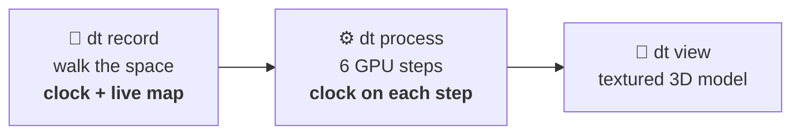
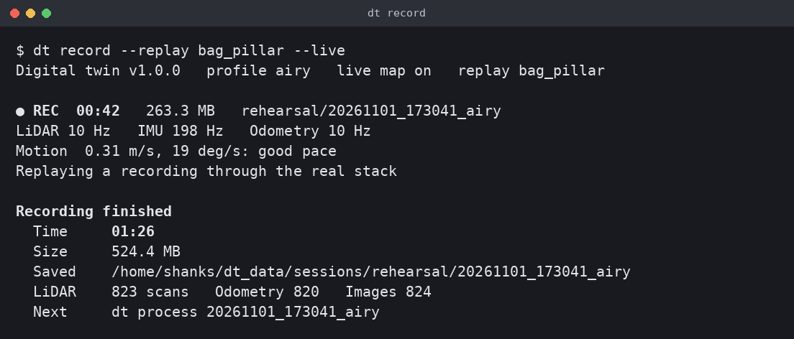
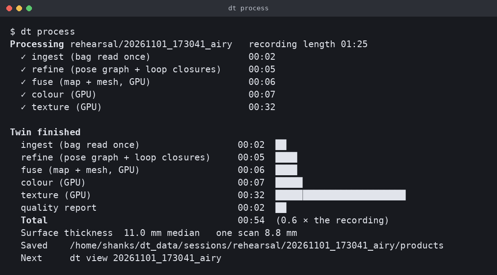
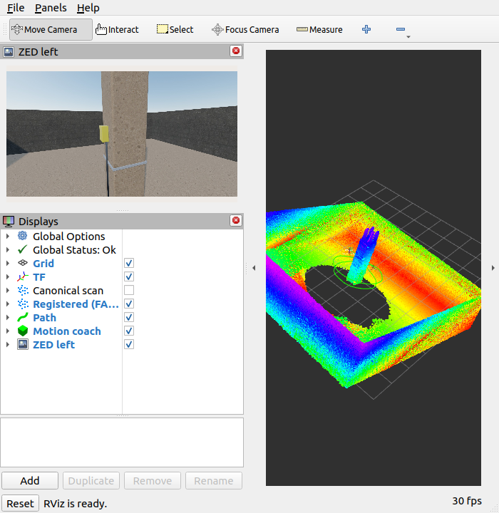
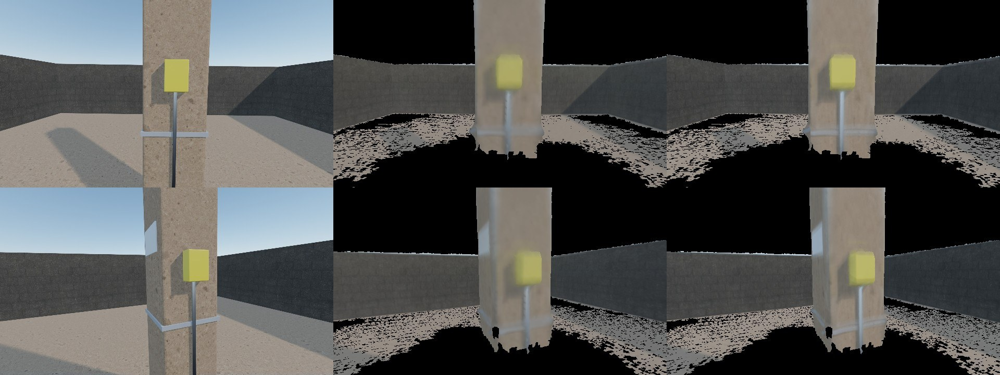
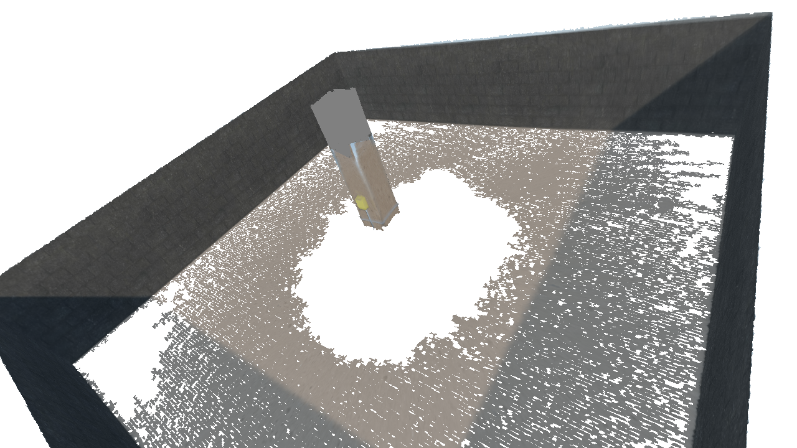
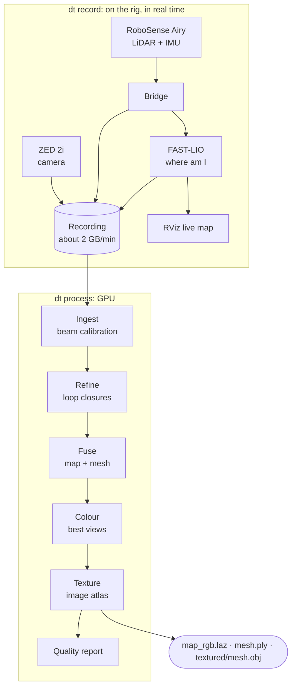
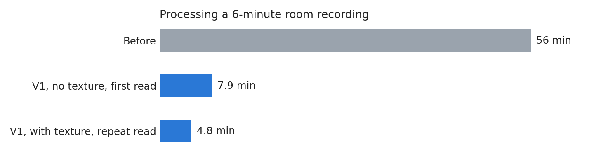
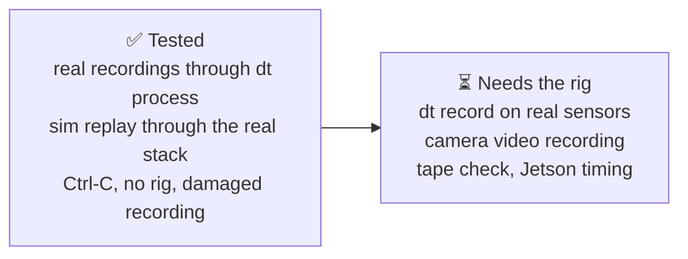

# Digital Twin

Walk through a space with a handheld LiDAR and camera rig. Get a measured, textured 3D model back in minutes.

**Version 1.0** · ROS 2 Humble · Jetson AGX Orin or an x86 laptop with an NVIDIA GPU



## Quick start

```bash
git clone https://github.com/Shashanksharma280201/digital-twin.git && cd digital-twin
./dt doctor      # what is ready on this machine
./dt install     # optional: use `dt` from anywhere

dt record --site home --live   # hold still 5 s, walk, return to the start, Ctrl-C
dt process                     # builds the newest recording
dt view                        # opens the 3D model
```

New machine? Run [`scripts/jetson/setup_all.sh`](scripts/jetson/README.md) on the rig or [`scripts/laptop/setup_laptop.sh`](scripts/laptop/setup_laptop.sh) on a laptop first.

## What you see

| 1. Recording | 2. Processing |
|---|---|
|  |  |

**3. Live map, while you walk** (`--live`): the point map grows next to the camera view. Colour and texture come later, from `dt process`.



**4. Finished model:** ground truth (left), per-point colour (middle), V1 texture (right).





*Simulated site. White gaps are ground the LiDAR hit too rarely to build a surface.*

## Commands

| Command | What it does |
|---|---|
| `dt record` | Starts the stack, waits for every sensor, records with a clock, health and pace advice |
| `dt process [recording]` | Builds the twin and times each step. Saves `timing.json` |
| `dt run` | Record, then process |
| `dt view [recording]` | Opens the model. `--mode textured\|mesh\|points` |
| `dt live` | Opens the live map on a stack that is already running |
| `dt list` | Every recording, its length, size and processing time |
| `dt doctor` / `dt stop` | Check this machine / stop anything left running |

Useful options: `--duration 300` stops on its own, `--no-camera` records LiDAR only, `--calibrate-rings` relearns the LiDAR beam calibration. `dt <command> --help` lists the rest.

## How it works



## Results



Laptop with an RTX 4060, 6-minute recording. Times for each step on the real room:

| ingest | refine | fuse | colour | texture | report | **total** |
|---|---|---|---|---|---|---|
| 0:47 | 0:27 | 0:34 | 1:14 | 1:42 | 0:04 | **4:48** |

| Accuracy | Real room | Simulated site |
|---|---|---|
| Shape error against truth | not measured | **9.5 mm** mean |
| Tape measure error | not measured | **5.6 mm** |
| Surface covered | 98 % coloured | **93 %** |
| Wall thickness in the map | 20.7 mm (target 12) | 11.0 mm |
| One scan on its own | 5.4 mm | 8.8 mm |

## Status



- `dt record` has run through the real stack with simulated sensor data, not yet with the physical sensors.
- Live view shows LiDAR points only. A live textured model is not part of V1.
- Real walls are thicker than target, and blurred frames soften the texture up close.

Try the whole flow with no rig. This needs Blender for the first command:

```bash
sim/run_pillar.sh --run ~/dt_data/sim/pillar
dt record --replay ~/dt_data/sim/pillar/bag_pillar --live
dt process
```

## Repository

```text
dt                terminal entry point
scripts/          dt_cli.py, process_session.sh, setup scripts
ros2_ws/src/      bridge, launch files, sensor profiles, recorder, health monitor
pipeline/         offline processing (dtp)
sim/              Blender simulation and ground-truth scoring
tests/            terminal tool tests
documents/        full guide, start at documents/README.md
research/         background research
```

Tests: `pytest tests` with system Python, then `pytest pipeline/tests sim/dt_sim/tests` with `~/dt_data/venvs/dt/bin/python -m`.
