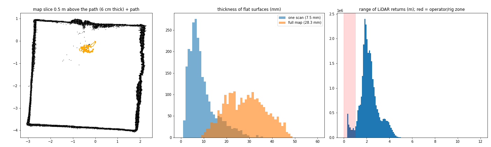

# Capture 3 review (2026-10-22, laptop + Airy + ZED 2i on the 21° stand)

Session: `~/dt_data/sessions/home/20261022_001306_airy` (12 GB: bag + zed.svo2 + products/).
Status: **discussion only — no changes made after this capture.**

## How to look at it

```bash
cd ~/Music/flo-mobility/digital-twin
S=~/dt_data/sessions/home/20261022_001306_airy

# Coloured mesh (the smooth twin). Drag = rotate, scroll = zoom, shift+drag = pan, Q = quit
~/dt_data/venvs/dt/bin/python scripts/view_map.py $S --mesh

# Coloured point map + scanner path (orange)
~/dt_data/venvs/dt/bin/python scripts/view_map.py $S

# Same points coloured by height
~/dt_data/venvs/dt/bin/python scripts/view_map.py $S --color height

# Numbers and plots (already generated; this re-prints them, ~2 min)
cat $S/products/quality/quality.json
xdg-open $S/products/quality/quality.png

# Export for CloudCompare / MeshLab / Blender
#   mesh:   $S/products/mesh.ply           (open directly)
#   points: $S/products/map_rgb.laz        (CloudCompare opens LAZ)
~/dt_data/venvs/dt/bin/python scripts/view_map.py $S --export /tmp/capture3_points.ply
```

Re-run the whole processing from the recording (≈ 55 min on the laptop today; stop the live
stack first with `bash scripts/jetson/stop_stack.sh`):

```bash
scripts/process_session.sh ~/dt_data/sessions/home/20261022_001306_airy
```

## Results vs earlier captures

| | Capture 1 (AGX, loose) | Capture 2 (stand) | **Capture 3** |
|---|---|---|---|
| Duration / path | – | 179 s / 7.3 m | 367 s / 18.1 m |
| Area the rig moved in | 25 × 12 cm | 32 × 40 cm | 74 × 53 cm |
| Turning (total / p90 rate) | 634° | 1,596° / 22 °/s | 5,456° / 31 °/s |
| Gap back at start | – | 39 cm | **4.4 cm** |
| Points with camera colour | 42 % | 55.8 % | **97.4 %** |
| Mesh flat-surface thickness | – | – | **2.5 mm** (p90 23 mm) |
| Point-map flat-surface thickness | 22.9 mm | 29.5 mm | 28.3 mm |
| One scan | 8.8 mm | 6.3 mm | 7.5 mm |




## What changed before this capture (all tested on capture 2 first)

- Dense FAST-LIO (every 2nd point, 0.2 m filters, 4 iterations, blind 0.5 m): walls 27.7 → 22.1 mm
  in replay, real time on the laptop (~1.8 cores). Finer (0.15 m) was worse (24.5 mm).
- Colour from the full-rate SVO2 (not the 7.7 Hz bag images); best views (sharp, close, central) win;
  blurred frames skipped; ZED left-lens offset (6 cm) fixed in `rig.py`.
- Target-free LiDAR↔camera calibration (`dtp extrinsic`): camera pitch was 3.5° off; now in the profile.
  
- TSDF mesh (`dtp mesh`, VDBFusion), loop-closure refine (`dtp refine`), operator zone (< 0.8 m) removed.
- Live camera preview at half size → 15.2 Hz (was 7.7). Airy factory IMU calibration tested and
  rejected (made walls worse, 25.1 vs 22.1 mm).

## Assessment

**Good:** room geometry — single straight walls, square corners, ~5.1 × 4.8 m room, path closes within
4.4 cm. Colour now covers nearly everything.

**Weak:** pale / washed-out colour; blurry detail (nothing small readable); lumpy furniture with
holes; speckled stripes along edges (door, curtains); point map still 28 mm thick; 56 min processing.

| Symptom | Main cause |
|---|---|
| Lumpy furniture, holes | Operator stayed in a 0.7 × 0.5 m spot and turned; everything seen from the room centre |
| Pale colour | ZED auto-exposure changes while turning; ~3,600 frames blended → grey-white |
| Blurry detail | Colour stored per mesh vertex (~3 cm spacing), not as an image texture |
| Edge speckle | LiDAR "mixed pixels" at depth edges (points floating between front and back surface) |
| 28 mm point map | 7.5 mm sensor noise per scan + small orientation/range errors; refine only fixes keyframe poses |
| 56 min processing | colour 24 min, mesh 11, refine 9, map 8.5 — all CPU, mostly single-threaded |

## Improvement options (to discuss)

1. **Capture technique** — walk a loop ~1–1.5 m from the walls, then a second loop the other way;
   sweep past objects sideways; turns a bit under 30 °/s. Biggest win, free.
2. **Camera exposure** — lock exposure / white balance during capture, or normalise brightness per frame.
3. **Image-textured mesh** (mvs-texturing / texrecon) instead of per-vertex colour; later a
   LiDAR-guided Gaussian splat (39 dB PSNR in the sim) for photo-real views.
4. **Cleaner geometry** — drop mixed-pixel edge points; 1.5–2 cm TSDF cells; remove small fragments;
   space carving for people / moving objects.
5. **Tighter point map** — plane bundle adjustment (BALM / HBA) or GLIM; stricter loop-closure checks
   (723 of 726 accepted is too permissive).
6. **Prove 1:1** — tape-measure 3–4 distances (room length/width, door, window) and compare.
7. **Faster processing (56 → ~5 min)** — colour and mesh on the RTX 4060; colour only from frames
   that moved ≥ 10 cm / 5° (~300, not 3,600); incremental voxel map; nearby-only loop candidates.
8. **Hardware** — bolt the sensors to the stand.

Suggested order: 1 + 2 (better capture), then 3 + 4 (looks), then 5–7 (accuracy, proof, speed).

## Known loose ends

- `dt_session` failed to stop the ZED SVO on Ctrl-C (stopped by hand both times); fix is in
  `dt_tools/session.py` and installed, not yet verified on a capture.
- AGX offline: temporary sudoers rule, artifact sync, Blender build (09) and verify (11) pending.
