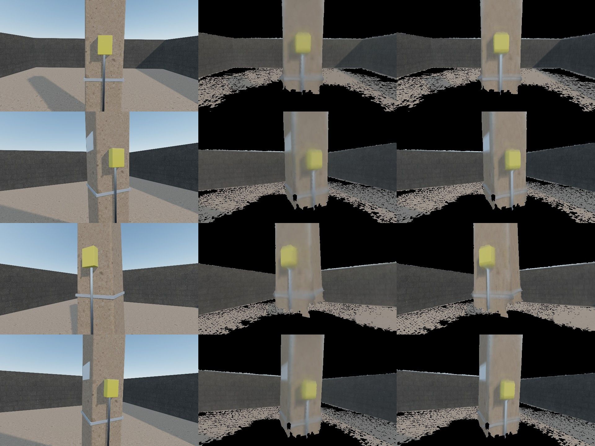

# Mesh and points improvements (2026-11-01)

Goal: finish the mesh + points work that does not need the rig, and test it in simulation.
Real data: capture 3 and capture 2, re-processed. Sim: pillar site with 6 mm of injected beam error, replayed through the real stack.

## Why walls were thick

Signed distance of about 8 million real points to the fused surface:

| | Real capture 3 | Sim |
|---|---|---|
| Per-beam range error | −13 to +19 mm | no effect |
| Scatter before / after removing it | 10.8 / 8.1 mm | 8.9 / 8.9 mm |

Thickness also counts every voxel once. On capture 3 it falls from 25.8 mm (all voxels) to 16.6 mm (seen 10+ times) and 7.6 mm (seen 300+ times). The mesh measures 2.4 mm.
`dtp polish` moved scans by only 3.5 mm and gave no gain (20.8 → 21.0 mm), so paths are not the main remaining cause and plane bundle adjustment was not built.

## Beam calibration (`dtp ringcal`)

- Sim: recovers injected errors with 0.82 correlation, 2.9 mm RMS. Map quality returns to the no-error run (13.3 vs 13.4 mm).
- Capture 3 on itself: one scan 7.5 → 5.4 mm. This is self-fit, so it overstates the gain.
- **Independent check:** capture 3's calibration on capture 2: one scan 6.2 → 5.9 mm, walls 24.5 → 22.8 mm. Calibrations learned separately from each capture correlate 0.80.
- Stored in `ros2_ws/src/dt_bringup/config/profiles/airy/ring_calib.json`.
- Limit: range and elevation only separate under motion, and capture 3 moved little. Re-run on a walking capture.

## Map cleanup (`dtp fuse --min-hits 3`)

Scored against true surfaces in the sim:

| Rule | Mean error | Coverage | Walls | Tape p95 |
|---|---|---|---|---|
| Keep all | 13.3 mm | 93.4% | 14.6 mm | 27.4 mm |
| Within 30 mm of the mesh | 12.3 mm | 86.6% | 13.7 mm | 25.6 mm |
| Seen 3+ times (chosen) | 9.9 mm | 92.4% | 11.1 mm | 22.1 mm |

The distance filter thins walls almost by construction and removes real surface where the mesh has holes, so it was rejected. Weak voxels go to `map_loose.laz`.

## Textured mesh (`dtp texture`)

Scored on frames held back from colouring. One brightness gain is fitted per frame, so this does not measure exposure.

| | Vertex colour | Texture | Real image |
|---|---|---|---|
| Real capture 3: PSNR | 17.63 dB | 17.84 dB | – |
| Real capture 3: fine detail | 8.4 | 17.0 | 55.2 |
| Sim: PSNR | 26.21 dB | 27.68 dB | – |
| Sim: fine detail | 9.3 | 16.6 | 61.0 |

Real PSNR stays low because the model lacks objects inside the 0.8 m self-zone and contains surfaces the camera does not see there.

The first version looked scrambled in the viewer: Open3D's viewer reads texture V downwards, while OBJ runs upwards, and the score above reads the file directly, so it did not catch this. `scripts/view_map.py --textured` now converts with `texture.viewer_uvs`. The OBJ file itself is standard.

## Scale in simulation

`dt_sim eval` fits the map to the true surfaces and runs a virtual tape measure over 20,000 point pairs: 53 ppm scale error, 6.0 mm median, 22.1 mm p95. This shows the pipeline adds no scale error. It does not prove the real rig: the sim has no real sensor scale error or clock offset.

## Processing time

Capture 3: 7.9 min on a first run, 4.9 min on a repeat run with calibration and texture. Colour took 204 s on a first run and 74 s on repeat with no code change. Skipping SVO frames did not help (60–76 s), so it was removed. The 3.4 min in the 2026-10-22 notes matches a repeat run without texture; that link is inferred.

## Still open

Real walls are 20.6 mm against a 12 mm target. Remaining: walking capture, locked exposure, close-object speckle, operator remnants, real tape check. See `documents/09-issues-and-roadmap.md`.
