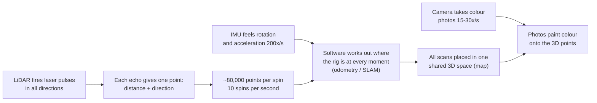
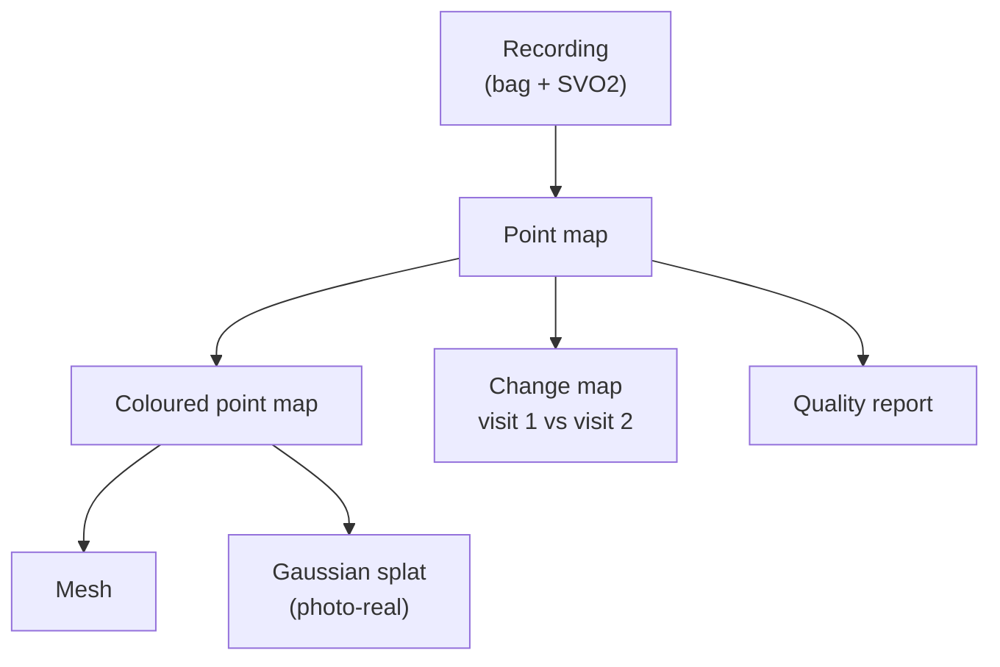

# 1. What is a digital twin?

## In one sentence

A digital twin is a **measured 3D copy of a real place** that you can open on a computer. Distances in the copy match distances in the real world (1:1 scale), so you can measure, inspect and compare without going back to the site.

## Why construction sites

A construction site changes every day. Teams need to know:
- **What was built?** Is the wall where the drawing says?
- **How much progress?** What changed since last week?
- **What is hidden?** Pipes and cables before the ceiling closes.
- **Is it safe and accurate?** Measurements without a tape and a ladder.

Walking the site once with a handheld scanner is much faster than measuring by hand. Doing it every week gives a history of the building.

## How the scanner "sees"

The hard part is **knowing where the scanner was** at each moment (its pose). A small error in position or angle puts the same wall in two places. Most of this project is about making that position estimate accurate, then cleaning and smoothing the result.

## What we deliver (the end products)

| Product | Plain words | File |
|---|---|---|
| Point map | Millions of 3D dots, each a measured surface point | `products/map.laz` |
| Coloured point map | The same dots, each with the camera's colour | `products/map_rgb.laz` |
| Mesh | A smooth surface made of small triangles, like a 3D game model | `products/mesh.ply` |
| Path | Where the scanner walked, with time | `products/traj_lidar.tum` |
| Quality report | Numbers and plots telling you how sharp and complete the scan is | `products/quality/` |
| Gaussian splat | A photo-real 3D view trained from the photos (tested in simulation) | `products/splat/` |
| Change map | What was added (green) or removed (red) between two visits | `products/diff/` |

## What "good" looks like

- Walls are thin and straight, not doubled or fuzzy.
- The model closes on itself: if you walk back to the start, the start and end line up.
- Most surfaces have true colour.
- Measurements in the model match a tape measure.

[Document 8](08-quality-and-results.md) shows how we measure these and what we have achieved.
