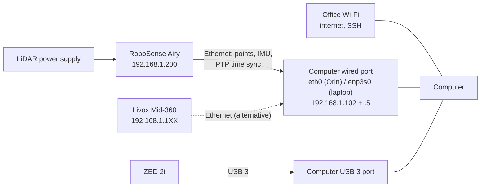
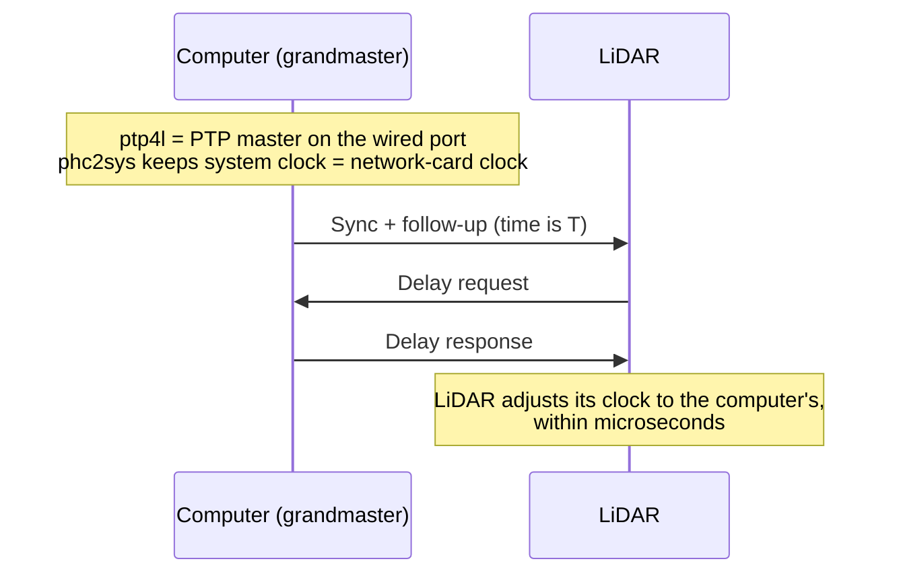
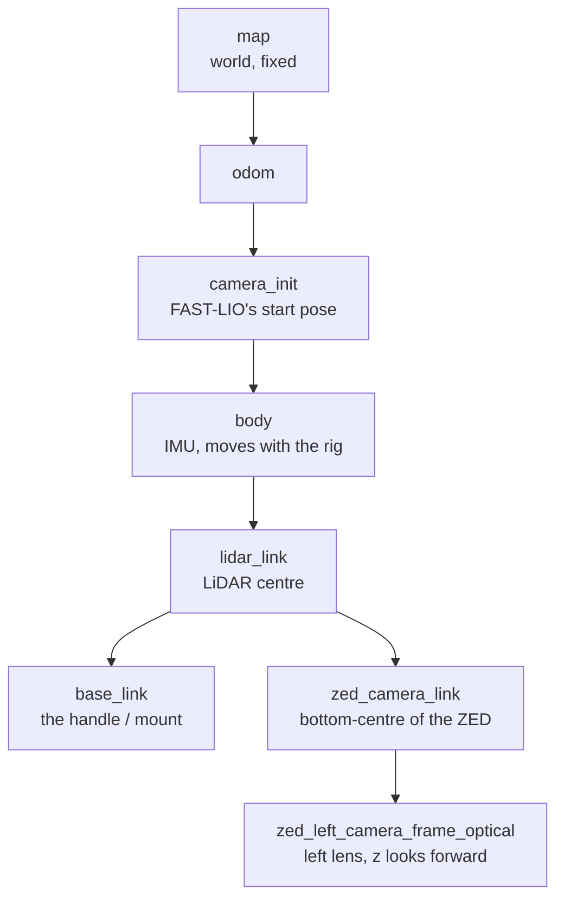

# 2. Hardware

## The parts

| Part | What it does | Key facts |
|---|---|---|
| **RoboSense Airy** (LiDAR, in use now) | Measures distances with lasers | 96 laser beams (rings), 10 scans/s, sees a dome from its horizon upward (0–90°). Built-in IMU. IP `192.168.1.200`. |
| **Livox Mid-360** (LiDAR, supported) | Same job, different design | Non-repetitive pattern, built-in IMU. IP `192.168.1.1XX` (XX = last two digits of its serial). |
| **ZED 2i** (stereo camera) | Records colour images | Recorded at HD1080, 30 fps into an SVO2 file; published to ROS at 15 Hz, half size (960×540). USB 3. |
| **Jetson AGX Orin 64 GB** (computer) | Runs the drivers, odometry and recorder on the rig | JetPack 6, ROS 2 Humble. Fixed IP `192.168.68.50` on the office network. |
| **Laptop** (computer, used for captures 2–3) | Same job as the Orin, for testing | x86-64 Ubuntu 22.04, RTX 4060. LiDAR on wired port `enp3s0`. |
| **Metal stand** | Holds LiDAR and camera rigidly together | Airy on a top plate tilted 21°, ZED on the front face. |

## Why both sensors must be fixed together

Colour is painted onto LiDAR points using one fixed transform between the two sensors (the extrinsic). If the camera moves even 0.5° relative to the LiDAR, colour lands 2.6 cm off at 3 m. So: **the handle may move freely, the two sensors may never move relative to each other.** Next step: replace tape with bolts (Airy M3 holes, ZED ¼″-20 thread).

## Why the Airy is tilted 21°

The Airy only sees from its horizon upward. Upright (capture 1) it saw almost no floor and lots of the operator. Tilted 21° on the stand (captures 2–3) it sees more floor and much less of the person holding it (operator points fell from 16% to under 5%).

## Wiring

The wired port is set to static addresses with no internet route (`scripts/jetson/05_setup_network.sh`), so the LiDAR network never hijacks your internet. Internet goes over Wi-Fi.

## Keeping clocks in sync (PTP)

Every point, IMU sample and image carries a time stamp. If the clocks disagree, the software matches a scan with the wrong position and the map smears.

- **PTP (Precision Time Protocol)** makes the computer the time master; the LiDAR follows it.
- PTP carries atomic time (TAI), 37 s ahead of normal time (UTC). We run `phc2sys -O 37 -S 1` to correct this; before the fix, LiDAR stamps were 37 s off.
- The Airy must be set once in its web page (`http://192.168.1.200`) to **PTP-E2E**.
- The laptop's network chip has no PTP hardware, so it uses software time stamps. It still locks (IMU latency 2–3 ms).
- The camera uses the system clock, which `phc2sys` keeps aligned.

## Coordinate frames (TF tree)

Every sensor measures in its own frame (its own x, y, z axes). The **TF tree** says how the frames sit relative to each other, so data from all sensors can be combined.

- FAST-LIO publishes `camera_init → body` (where the rig is now).
- `body → lidar_link` is the IMU-to-LiDAR offset (identity for the Airy after the bridge rotates the IMU).
- `lidar_link → zed_camera_link` comes from `rig.yaml` (`T_lidar_camera`). On the stand it is about 14 cm forward, 9 cm down, pitched 24.5° (refined by `dtp extrinsic`).
- The left lens is 6 cm to the side of the ZED's mount point; the pipeline includes this offset (`T_LINK_LEFT_ZED2I` in `pipeline/dt_pipeline/rig.py`).

The rig geometry for each LiDAR lives in `ros2_ws/src/dt_bringup/config/profiles/<airy|mid360>/rig.yaml`.

## Airy quirks worth knowing

| Quirk | How we handle it |
|---|---|
| IMU reports acceleration in g, and its axes are rotated against the point cloud | `dt_lidar_bridge` multiplies by 9.80665 and rotates with `R = [0,-1,0; -1,0,0; 0,0,-1]` (`profiles/airy/bridge.yaml`) |
| Point times are absolute seconds (float64) | Bridge converts them to seconds since scan start |
| Driver needs two build options | `rslidar_sdk` built with `POINT_TYPE XYZIRT` and `ENABLE_IMU_DATA_PARSE ON` (done by `07_build_workspace.sh`) |
| Factory IMU calibration in its status packet (0.69° from nominal) | Tested on capture 2: made maps worse (25.1 vs 22.1 mm). Not used. |
