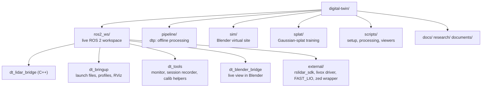
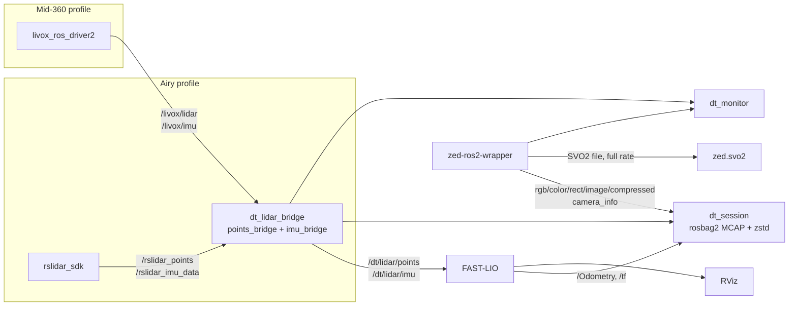

# 3. Software architecture

## Two halves

1. **Live (online)**: runs on the rig while you walk. Built on **ROS 2 Humble** (Robot Operating System: programs called *nodes* that pass messages on named channels called *topics*). Job: read sensors, estimate the path, record everything.
2. **Offline (post-processing)**: runs after the walk, on the recording. Built in Python (`dtp`). Job: turn the recording into the best possible 3D model.

Splitting them means the live part stays light and real-time, and the offline part can take its time and be re-run with better settings at any point.

## Repository map



| Folder | What is in it |
|---|---|
| `ros2_ws/src/dt_lidar_bridge` | C++ nodes `points_bridge` and `imu_bridge`. Convert either LiDAR's output into one common format (the canonical contract below). Unit tests in `test/test_canonical.cpp`. |
| `ros2_ws/src/dt_bringup` | Launch files `sensors`, `slam`, `capture`; per-LiDAR profiles in `config/profiles/{airy,mid360}/` (`rig.yaml`, `bridge.yaml`, `fast_lio.yaml`, driver config); ZED configs; RViz layouts `dt.rviz` and `calib.rviz`. |
| `ros2_ws/src/dt_tools` | `dt_monitor` (live health), `dt_session` (recorder), `dt_overlay_check` (projects LiDAR into the image), `dt_glim_config`, `dt_apply_camera_calib`. |
| `ros2_ws/src/dt_blender_bridge` | Streams pose and growing map to Blender over TCP. |
| `ros2_ws/src/external` | Upstream code pulled by `dt.repos`: `rslidar_sdk` v1.5.20, `rslidar_msg`, `livox_ros_driver2`, `FAST_LIO` (ROS 2 branch), `zed-ros2-wrapper`. |
| `ros2_ws/src/livox_msgs_only` | Laptop only: Livox message definitions without the driver (FAST-LIO needs them to compile). Ignored on the Orin. |
| `pipeline/dt_pipeline` | The `dtp` command: `traj`, `refine`, `map`, `colorize`, `extrinsic`, `mesh`, `clean`, `align`, `diff`, `colmap`, `info`. |
| `sim/` | Blender scripts, `dt_sim` (simulated sensors + evaluation), `run_demo.sh`. |
| `splat/` | `train_splat.py`, `render_flythrough.py` (gsplat). |
| `scripts/jetson/` | Orin setup steps `00`–`11`, `setup_everything.sh`, `env.sh`, `stop_stack.sh`. |
| `scripts/laptop/setup_laptop.sh` | Laptop setup. |
| `scripts/process_session.sh` | One command from recording to finished twin. |
| `scripts/view_map.py` | 3D viewer for points or mesh. |
| `scripts/analysis/` | `map_quality.py` (quality report), `replay_lio.sh` (re-run FAST-LIO on a recording with other settings). |

## The canonical sensor contract

The two LiDARs speak different "dialects". The bridge translates both into one format, so everything after it works with either LiDAR unchanged.

| Topic | Contents |
|---|---|
| `/dt/lidar/points` | Point cloud with fields `x, y, z, intensity, time` (float32, seconds since the scan's header time, sorted) and `ring` (uint16). Frame `lidar_link`. |
| `/dt/lidar/imu` | IMU in m/s² and rad/s, rotated into the LiDAR's axes. Frame `body`. |

FAST-LIO reads these with `lidar_type: 2` (Velodyne-style cloud).

## Data flow while recording



Message transport uses **CycloneDDS** with large network buffers (each Airy cloud is about 2 MB; the default transport could not keep up).

## A session folder

Every recording is one folder under `~/dt_data/sessions/<site>/<date>_<time>_<profile>/`:

```
bag/            rosbag2 recording (MCAP, zstd): points, IMU, odometry, TF, camera preview
zed.svo2        full-rate camera video (ZED format)
rig.yaml        sensor geometry at capture time (copied from the profile)
meta.yaml       site, note, start/end time, topics, PTP status
products/       everything dtp writes: traj_lidar.tum, map.laz, map_rgb.laz, mesh.ply, quality/ ...
```
