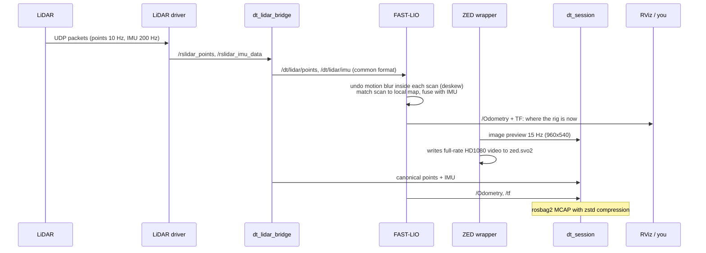

# 4. Live capture: what happens while you walk

## The short version

1. Start the stack: drivers, bridge, FAST-LIO, camera, health monitor, RViz.
2. Start the recorder.
3. Hold still 5 s, walk the space, return to the start, hold still 5 s.
4. Stop the recorder.

## Step by step inside the computer



## The pieces

### Drivers
- **Airy:** `rslidar_sdk` reads UDP packets and publishes `/rslidar_points` and `/rslidar_imu_data`. The driver loads this unit's beam-angle calibration from its status packets (DIFOP) automatically.
- **Mid-360:** `livox_ros_driver2` publishes `/livox/lidar` and `/livox/imu`.
- **ZED 2i:** `zed-ros2-wrapper` publishes `/zed/zed_node/rgb/color/rect/image` (and `/compressed`) plus `camera_info`. Camera tracking, depth and TF are switched off; the LiDAR owns the positions.

### Bridge (`dt_lidar_bridge`)
Turns either LiDAR into one common format. For each scan it: decodes the fields, drops points closer than 0.3 m or NaN, converts per-point time to "seconds since scan start", sorts points by time (counting sort, ~10 ms per scan), and rotates and scales the IMU.

### FAST-LIO (odometry)
**FAST-LIO2** is the "where am I" engine. It is a **LiDAR-inertial odometry (LIO)**: it predicts motion from the IMU between scans, then corrects it by matching each new scan to the map built so far (an iterated Kalman filter). It also **deskews**: during one 0.1 s spin the rig moves, so each point is moved back to where it would be if the whole scan were taken at one instant.

Current Airy settings (`profiles/airy/fast_lio.yaml`, chosen by replay tests on capture 2):

| Setting | Value | Meaning |
|---|---|---|
| `point_filter_num` | 2 | use every 2nd point |
| `filter_size_surf` / `filter_size_map` | 0.2 m | grid size for scan and map points |
| `max_iteration` | 4 | correction steps per scan |
| `blind` | 0.5 m | ignore points this close (operator's hands) |

It runs at 10 Hz on about 1.8 CPU cores of the laptop.

### Recorder (`dt_session`)
`ros2 run dt_tools dt_session record --site <site> --profile <airy|mid360> --note "..."` creates the session folder, copies `rig.yaml`, asks the ZED to record `zed.svo2`, and runs `ros2 bag record` (MCAP, zstd) on:
- the common-format points and IMU,
- the raw driver topics (unless `--lean`),
- camera preview and camera_info (unless `--no-camera`),
- `/Odometry`, `/tf`, `/tf_static`, `/diagnostics`.

Ctrl-C stops the bag and then the SVO.

### Health monitor (`dt_monitor`)
Prints a table and publishes `/diagnostics`:
- rate of every stream (LiDAR 10 Hz, IMU 200 Hz, camera 15 Hz, odometry 10 Hz);
- latency: now minus the message's time stamp;
- clock problems: stamps that look like "seconds since power-on" (PTP not locked), or a 37 s offset (UTC vs TAI);
- the IMU gravity vector (should be about 9.81 m/s² pointing up at rest).

### RViz (live view)
- `rviz_config:=calib` shows the sensor frames, the live LiDAR scan and the camera image with LiDAR points drawn on top. Fixed frame `map`, the view orbits the rig. Mouse: drag rotates, scroll zooms, Shift+drag pans.
- `rviz_config:=dt` is the general capture view.

## How to move during a capture

| Rule | Why |
|---|---|
| Hold still 5 s at the start | FAST-LIO and the IMU settle (gravity, biases) |
| Walk 0.3–0.5 m/s, about one slow step per second | Keeps every surface in many scans; fine for the LiDAR |
| Turn at most 20–30 °/s (a quarter turn in 3–4 s) | Fast turns blur the camera and stress the odometry |
| Turn in wide arcs while walking; **do not spin on the spot** | Spinning gives one viewpoint, holes behind objects, and drift |
| Walk a loop near the walls, then a second loop the other way | Every surface seen twice; loop closures can correct drift |
| Keep the rig at chest height, in front of you | Keeps you out of the scan |
| Finish at the exact start spot, same direction, hold 5 s | Lets us check and correct drift (return-to-start gap) |
| 2–4 minutes per room | Enough data without huge files |

## Starting and stopping (commands)

```bash
./dt doctor                                # check this machine
./dt record --site home --note "what and where" --live
# hold still 5 s, walk, return to the start, hold still 5 s, then Ctrl-C
./dt process                               # the newest recording
./dt view
```

`dt record` starts the stack, waits until LiDAR, IMU, camera and odometry all flow, then records. It shows the clock, data size, stream rates and the motion coach. Ctrl-C closes the bag, reports what was recorded and stops the stack. Add `--duration 300` to stop on its own.

`--live` opens RViz (`rviz_config:=live`): the FAST-LIO map grows as you walk, next to the camera view. It shows LiDAR points, not the coloured mesh; colour and texture come from `dt process`. On a machine with no screen, recording continues without it. From a second terminal, `dt live` opens the same view.

No rig: `./dt record --replay BAG` plays a driver-level bag from `sim/run_pillar.sh` through the real stack and recorder.

Done by hand, the same thing is:

```bash
source scripts/jetson/env.sh
ros2 launch dt_bringup capture.launch.py profile:=airy rviz:=true rviz_config:=live     # terminal 1
ros2 run dt_tools dt_session record --site home --profile airy --note "what and where"  # terminal 2
bash scripts/jetson/stop_stack.sh
```
