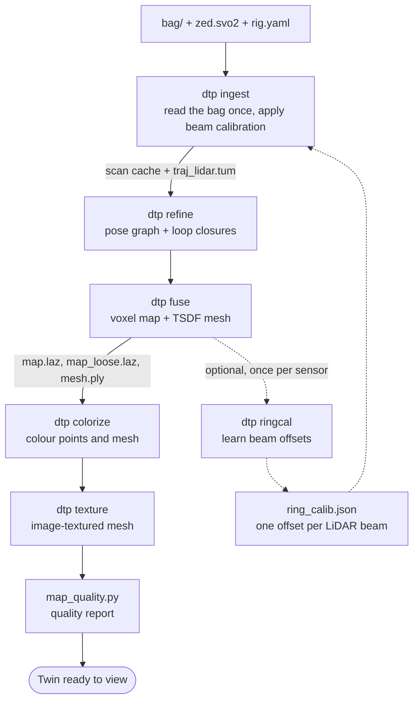
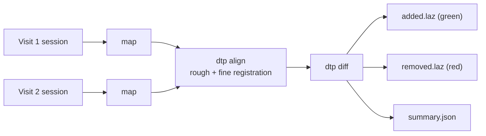
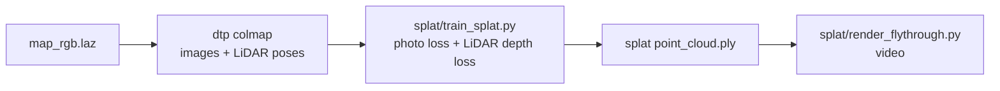

# 5. Post-processing: from recording to 3D model

All steps are sub-commands of **`dtp`** (package `pipeline/dt_pipeline`, installed in the venv `~/dt_data/venvs/dt`). Each reads the session folder and writes into `SESSION/products/`. You can re-run any step with other settings without recording again.

## The main chain

`scripts/process_session.sh SESSION` runs this whole chain and prints the time of each step. It uses the GPU where it can.

## Each step in plain words

### `dtp ingest`: read the recording once
Reads the bag, drops "mixed pixels" (points floating at depth edges), applies the beam calibration if there is one, and writes a fast scan cache (`products/cache/`, about 1.5 GB per minute of Airy capture, safe to delete) plus FAST-LIO's path as `traj_lidar.tum`. Real sessions take the calibration from `config/profiles/<profile>/ring_calib.json` unless they hold their own.

### `dtp ringcal`: calibrate each laser beam, no target needed
Each of the Airy's 96 beams has its own small range and angle error, so each draws the same wall in a slightly different place. The mesh averages all beams, so a beam's average distance from the mesh is its error. `dtp ringcal` learns one range and one elevation offset per beam and writes `ring_calib.json`. The shared average is removed on purpose, so calibration can never change the map's scale. It needs a recording with movement: a rig that stands still cannot tell a range error from an angle error. Run it once per sensor, with `process_session.sh --calibrate-rings`.

### `dtp refine`: fix slow drift (loop closure)
FAST-LIO never looks back. If its heading drifts by 3°, a wall seen again later lands 15 cm beside its first copy.
1. Pick **keyframes** every 0.25 m or 15° of motion.
2. Give each keyframe a small local map from its neighbouring scans.
3. Re-align consecutive keyframes with **GICP** (a precise point-cloud alignment).
4. When the rig comes back near an earlier keyframe (within 2 m, more than 10 s later), align the two as a **loop edge**.
5. Solve the **pose graph** (all keyframes and edges together) and spread the correction smoothly over the full path.

The original path is kept as `traj_lidar_odom.tum`.

### `dtp fuse`: the point cloud and the mesh
Moves every point of every scan into world coordinates at its exact time (deskew), in one GPU pass that builds both products:
- **Point map:** points merge into 2 cm cubes (voxels). Each voxel counts once, so a voxel with one stray return weighs as much as one with a thousand. Voxels with fewer than 3 returns go to `map_loose.laz` (`--min-hits`), so nothing is thrown away.
- **Mesh (TSDF fusion):** space is cut into 2 cm cells and every laser ray votes on how far each cell is from the surface. Thousands of votes cancel the sensor noise, and the surface is where the average crosses zero. Cells seen fewer than 3 times and small fragments are dropped.

`--self-zone 0.8` removes returns closer than 0.8 m (operator and rig). Real objects that close are removed too.

### `dtp colorize`: true colour
For every camera frame:
1. Work out where the camera was: path at that time × LiDAR-to-camera transform.
2. Project map points into the image.
3. Keep only points that are actually visible (a small depth buffer stops a wall behind a pillar getting the pillar's colour).
4. Add the pixel colour to the point with a weight.

Details:
- **Source:** the full-rate `zed.svo2` (`--source auto` prefers it over the bag preview).
- **Keyframes:** a frame is used only if the camera moved 5 cm or turned 4°.
- **Blur filter:** frames less sharp than 0.6 × the running median are skipped (sharpness = variance of the Laplacian).
- **Exposure:** each frame's brightness is matched to the colours already collected.
- **Best views win:** sharp, close, central views dominate.

Output: `map_rgb.laz` and vertex colours in `mesh.ply`.

### `dtp extrinsic`: calibrate camera against LiDAR, no target needed
With the right transform, one wall point looks the same colour in every frame that sees it. With a wrong one, it picks up different colours. The step searches rotation and translation around the current guess to make colours most consistent over 80 sharp frames (photometric consistency). On capture 2 it found the camera pitch 3.5° off; consistency improved 12%. `--apply` writes the result to the session's `rig.yaml`.

### `dtp texture`: sharp colour on the mesh
A mesh corner every 2 cm cannot hold finer colour than that, so each triangle gets its own small patch of a texture image, and each texel is coloured from the best camera views. Output: `products/textured/mesh.obj` + `.mtl` + `.png`. View it with `scripts/view_map.py SESSION --textured`. Nearby objects removed by the self-zone are not in the mesh, so the visibility test cannot see them: their colour can land as speckle on the surface behind.

### Quality report
`scripts/analysis/map_quality.py SESSION` writes `products/quality/quality.json` and `quality.png`. See [document 8](08-quality-and-results.md).

## Other steps

| Command | Plain words | Output |
|---|---|---|
| `dtp info SESSION` | Summary of what is in the bag | printed JSON |
| `dtp clean SESSION` | Remove moving things (people, cars) and ghosts: DUFOMap, or a "seen-through" test as fallback | `map_static.laz`, `map_dynamic.laz` |
| `dtp align REF SESSION` | Line up a new visit with an old one (FPFH + RANSAC rough match, then GICP) | `T_ref_session.txt` |
| `dtp diff REF SESSION` | What was added or removed between visits (voxel comparison; optional M3C2) | `products/diff/` |
| `dtp colmap SESSION` | Export images + poses + coloured points for Gaussian-splat training | `products/colmap/` |

## Change detection between two visits

## Photo-real view (Gaussian splat)

Camera poses come from the LiDAR path, so the splat is in true metres. In the simulation it reached 39.1 dB PSNR. On real capture 3 it reached 21.5 dB at low resolution ([research 11](../research/11-pixel-prediction-vs-coverage.md)). A splat is for viewing, not measuring.

## How long it takes (capture 3, 6-minute recording, laptop)

| Step | Old CPU pipeline | GPU, first run | GPU, files already in memory, with calibration and texture |
|---|---|---|---|
| Read recording | 1.2 min | 1.5 min | 0.8 min |
| Fix drift | 9.4 min | 1.1 min | 0.4 min |
| Map + mesh | 19.8 min | 1.6 min | 0.6 min |
| Colour | 24.2 min | 3.4 min | 1.3 min |
| Texture | – | – | 1.7 min |
| Quality report | 1.8 min | 0.3 min | 0.1 min |
| **Total** | **56 min** | **7.9 min** | **4.9 min** |

Reading the recording from disk is the main difference between the two GPU columns; this is inferred from the step times, not isolated. Learning a new calibration adds about 2 minutes.
