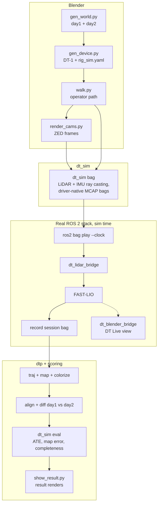

# 6. Simulation: a virtual construction site in Blender

## Why simulate

On a real site we never know the exact truth, so we cannot say exactly how wrong the model is. In a virtual site we know every wall to the millimetre and the true path of the scanner (ground truth). The simulation lets us test the **unchanged** live stack and the pipeline, and score them in centimetres.

## What is simulated

| Piece | Tool | File |
|---|---|---|
| Construction site, two days (day 2 has changes) | Blender 5.2 | `sim/blender/gen_world.py` |
| The DT-1 handheld device with Airy or Mid-360 + ZED 2i | Blender | `sim/blender/gen_device.py` (writes `rig_sim.yaml`) |
| Operator walking with the device | Blender | `sim/blender/walk.py` (`trajectory.csv`, 1 kHz, first 3 s still) |
| Camera images | Blender EEVEE | `sim/blender/render_cams.py` |
| LiDAR and IMU | Open3D ray casting (Embree), ~3.5 M rays/s | `sim/dt_sim` (`lidar_airy.py`, `lidar_mid360.py`, `imu.py`) |
| Scoring against truth | Python | `dt_sim eval` |
| Result pictures | Blender | `sim/blender/show_result.py` |

## Why there is a file-based bridge

Blender 5.2 uses Python 3.13; ROS 2 Humble uses Python 3.10, so Blender cannot load ROS directly. We built two bridges:
- **Blender → ROS (sensor data):** Blender exports the world, path and device; `dt_sim` writes bags with the **same topics the real drivers publish** (`/rslidar_points` or `/livox/lidar`, raw IMU in g, ZED images); `ros2 bag play --clock` feeds them to the real stack.
- **ROS → Blender (live view):** `dt_blender_bridge` sends the estimated pose and growing map over TCP (port 5577); the **DT Live** add-on draws them in Blender.

## The whole demo (`sim/run_demo.sh`)



Run it:

```bash
cd ~/Music/flo-mobility/digital-twin
source scripts/jetson/env.sh
DT_WS=$PWD/ros2_ws DT_VENV=$DT_VENV ./sim/run_demo.sh --profile airy        # or mid360
# options: --live (watch in Blender) --splat (photo-real) --no-hero (skip device renders) --rate R --cam-rate HZ
python3 sim/view_twin.py   # interactive view of the simulated twin
```

Outputs go to `~/dt_data/sim/demo_<profile>/`: `result_day1.png` (twin coloured by error), `result_rgb_day1.png` (with camera colour), `result_day2.png` (changes), `eval_day1.json`, `eval_day2.json`.

## Simulation results

| Measure | Result |
|---|---|
| Path error (ATE) | about 1.0–1.7 cm |
| Map shape error, pillar site, after fitting the map to the true surfaces | 9.9 mm mean |
| Virtual tape measure, 20,000 point pairs | 6.0 mm median, 22.1 mm p95 |
| Scale error | 53 ppm |
| Surfaces coloured by the camera | 87% |
| Gaussian splat image quality | 39.1 dB PSNR |

`dt_sim eval` reports two map scores. `map` is aligned by the path alone, so any small tilt of the path counts as map error (this gave the older 2.6–3 cm figures). `map_surface` fits the map to the true surfaces first, so it measures shape and scale.

To test beam calibration, `dt_sim bag --ring-bias-mm 6` gives each Airy ring a known range error and saves the truth to `ring_bias_truth.json`. On the pillar site, `dtp ringcal` recovers it with 0.82 correlation and 2.9 mm RMS error.

Real captures are harder than the simulation: real sensors have per-beam errors, mixed pixels at edges, auto-exposure and a person holding the rig. See [document 8](08-quality-and-results.md).

## Known limits

- The simulated Airy assumes 96 evenly spaced rings over 0–90° and the IMU at the LiDAR centre.
- Camera rendering takes about 0.9 s per 720p frame on an RTX 4060, so the demo renders at 5 Hz by default.
- Use CycloneDDS with large buffers (or `--rate 0.25`) for the Airy, or FAST-LIO starves.
