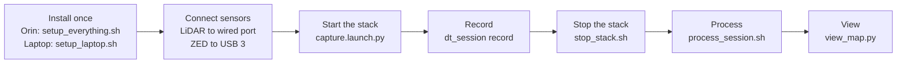

# 7. Setup and run: copy-paste commands

All commands assume the project is at `~/Music/flo-mobility/digital-twin`. On the Orin the same folder layout is used.

## The journey



## A. Install on the Jetson AGX Orin (once, about 3–4 h)

```bash
cd ~/Music/flo-mobility/digital-twin/scripts/jetson
./setup_everything.sh --iface eth0        # resumable: --from 07, skip steps: --skip 09,11
```

What the steps do:

| Step | Script | Does |
|---|---|---|
| 00 | `00_check_system.sh` | Read-only check: L4T, CUDA, disk, network, PTP support, ZED on USB |
| 01 | `01_install_ros_humble.sh` | ROS 2 Humble, colcon, CycloneDDS, MCAP/zstd, PCL, linuxptp |
| 02 | `02_install_livox_sdk2.sh` | Livox-SDK2 (for the Mid-360) |
| 03 | `03_install_zed_sdk.sh` | ZED SDK matching this JetPack |
| 04 | `04_install_glim.sh` | GLIM (global LiDAR mapping, optional back-end) |
| 05 | `05_setup_network.sh eth0` | Static LiDAR IPs 192.168.1.5 and .102, big UDP buffers, CycloneDDS config |
| 06 | `06_setup_ptp.sh eth0` | PTP grandmaster services `dt-ptp4l`, `dt-phc2sys` |
| 07 | `07_build_workspace.sh` | Pulls drivers and FAST-LIO, patches, builds `ros2_ws` |
| 08 | `08_install_python_tools.sh` | Venv `~/dt_data/venvs/dt` with `dtp` and `dt_sim`, runs tests |
| 09 | `09_install_blender.sh` | Builds Blender 5.2 for ARM64 from source (1–2 h) |
| 10 | `10_install_splat.sh` | Optional, experimental: gsplat on the Orin |
| 11 | `11_verify.sh` | Unit tests + full Blender sim on the Orin, prints PASS/FAIL |

One manual step for the Airy: open `http://192.168.1.200` → Setting → Time Synchronization Source → **PTP-E2E**, save, power-cycle.

Access the Orin: `ssh agx` (192.168.68.50).

## B. Install on a laptop (x86-64 Ubuntu 22.04, ROS 2 Humble and ZED SDK already installed)

```bash
cd ~/Music/flo-mobility/digital-twin
scripts/laptop/setup_laptop.sh --iface enp3s0     # apt packages, LiDAR network, PTP, workspace build
```

## C. Every new terminal

```bash
cd ~/Music/flo-mobility/digital-twin
source scripts/jetson/env.sh          # ROS, workspace, CycloneDDS, DT_DATA, DT_VENV
```

## D. Record a capture

```bash
# Terminal 1: sensors + odometry + health monitor + RViz
ros2 launch dt_bringup capture.launch.py profile:=airy rviz:=true rviz_config:=calib

# Terminal 2: record (hold still 5 s, walk, return to start, hold still 5 s, then Ctrl-C)
ros2 run dt_tools dt_session record --site home --profile airy --note "what and where"

# When finished, stop every stack process (run this as its own command)
bash scripts/jetson/stop_stack.sh
```

Useful launch options: `profile:=mid360`, `camera:=false`, `slam:=glim`, `rviz_config:=dt`.

The session folder appears in `~/dt_data/sessions/home/<date>_<time>_airy/`.

## E. Process a capture

```bash
S=~/dt_data/sessions/home/20261022_001306_airy      # your session
scripts/process_session.sh $S                       # traj -> refine -> map -> colour -> mesh -> quality
# options: --self-zone 0.8  --no-refine  --no-mesh
```

Single steps (all in `$DT_VENV/bin/`):

```bash
dtp traj $S
dtp refine $S
dtp map $S --voxel 0.02 --min-range 0.8
dtp colorize $S --every 2
dtp extrinsic $S --apply          # optional: recalibrate camera vs LiDAR from this capture
dtp mesh $S --min-range 0.8
$DT_VENV/bin/python scripts/analysis/map_quality.py $S
```

## F. View the result

```bash
P=~/dt_data/venvs/dt/bin/python
$P scripts/view_map.py $S --mesh            # smooth coloured mesh
$P scripts/view_map.py $S                   # coloured points + path (orange)
$P scripts/view_map.py $S --color height    # points coloured by height
$P scripts/view_map.py $S --export twin.ply # for CloudCompare / MeshLab / Blender
xdg-open $S/products/quality/quality.png    # quality plots
```

Mouse in the viewer: drag rotates, scroll zooms, Shift+drag pans, Q quits.

`mesh.ply` opens directly in MeshLab, CloudCompare or Blender. `map_rgb.laz` opens in CloudCompare.

## G. Test FAST-LIO settings on an old recording (no sensors needed)

```bash
scripts/analysis/replay_lio.sh SESSION path/to/fast_lio_variant.yaml ~/dt_data/experiments/OUT 1.0
# prints wall thickness, return-to-start gap and FAST-LIO CPU use for that variant
```

## Common problems

| Symptom | Fix |
|---|---|
| No LiDAR data | Check the cable and `ip addr` shows 192.168.1.102 on the wired port; ping 192.168.1.200 |
| Time stamps 37 s off | `phc2sys` must run with `-O 37 -S 1`; power-cycle the Airy once |
| Bridge or nodes missing after restart | Old nodes still running: `bash scripts/jetson/stop_stack.sh`, then launch again |
| RViz view does not move with the mouse | Use the configs in `dt_bringup/rviz/` (they now include the camera tools) |
| Camera image rate low | The ROS preview is half size; colour uses `zed.svo2` at full rate anyway |
