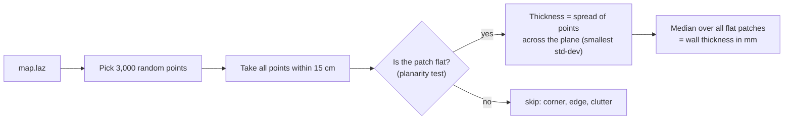
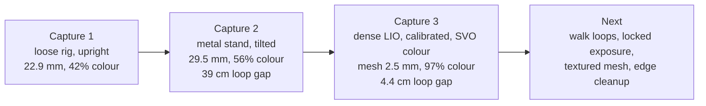

# 8. Quality and results

## How we measure quality

| Measure | Plain words | Good value |
|---|---|---|
| **Wall thickness, one scan** | How noisy the sensor is on its own | 6–9 mm for the Airy |
| **Wall thickness, full map** | How fuzzy walls get after combining all scans; doubled walls make it large | close to one scan; target ≤ 12 mm |
| **Blur added by combining** | full map ÷ one scan | close to 1× |
| **Mesh thickness** | Same test on points sampled from the mesh | a few mm |
| **Return-to-start gap** | Distance between where you started and where you ended (if you came back) | < 2 cm |
| **Coloured %** | Share of map points that got a camera colour | ≥ 85% |
| **Ranges** | Share of LiDAR returns per distance; < 1 m is mostly the operator | operator < 5% |
| **Capture motion** | Path length, area covered, total turning, turning rate | walk, do not spin |

All numbers come from `scripts/analysis/map_quality.py` (`products/quality/quality.json` and `quality.png`). The plot shows a top-down slice of the walls with the path, the thickness histograms, and the range histogram.

What this does **not** measure on a real capture: true scale. That needs 3–4 tape-measured distances in the room. In simulation the truth is known, so `dt_sim eval` measures it directly (below).

Thickness counts each voxel once, so it is sensitive to stray points: the same capture 3 map measures 25.8 mm with all voxels, 16.6 mm with voxels seen 10+ times and 7.6 mm with voxels seen 300+ times.

## Results so far

| | Simulation | Capture 1 | Capture 2 | Capture 3 |
|---|---|---|---|---|
| Computer | laptop | AGX Orin | laptop | laptop |
| Rig | virtual DT-1 | Airy resting on ZED, upright | Airy + ZED on metal stand, 21° tilt | same stand, refined calibration, dense FAST-LIO |
| Path error vs truth | 1.0–1.7 cm | – | – | – |
| Area the rig moved in | – | 25 × 12 cm | 32 × 40 cm | 74 × 53 cm |
| Total turning | – | 634° | 1,596° | 5,456° |
| Return-to-start gap | – | 5 mm (barely moved) | 39 cm | **4.4 cm** |
| Wall thickness, one scan | – | 8.8 mm | 6.3 mm | 7.5 mm |
| Wall thickness, full map | 2.6 cm mean map error | 22.9 mm | 29.5 mm | 28.3 mm |
| Mesh thickness | – | – | – | **2.5 mm** |
| Operator points (< 1 m) | – | 16% | 4.7% | 5.3% |
| Coloured | 87% | 42% | 55.8% | **97.4%** |

Capture folders: capture 2 `~/dt_data/sessions/home/20261021_222553_airy`, capture 3 `~/dt_data/sessions/home/20261022_001306_airy`. Detailed write-ups: `docs/analysis/2026-10-21-first-real-capture-analysis.md`, `docs/analysis/2026-10-22-capture-3-review.md`.

## Current pipeline (2026-11-01)

Beam calibration, loose-point split and textured mesh. Details: `docs/analysis/2026-11-01-mesh-and-points-improvements.md`.

| Capture 3 | Before | Now |
|---|---|---|
| One scan | 7.5 mm | **5.4 mm** |
| Full map walls | 27.4 mm | **20.6 mm** (target 12 mm) |
| Return-to-start gap | 4.2 cm | 4.3 cm |
| Coloured | 96.5% | 98.4% |
| Processing | 7.9 min first run | 4.9 min repeat run, including texture |

Simulation, pillar site with 6 mm of injected beam error, scored against the true surfaces:

| | Raw | With calibration | + loose points split off |
|---|---|---|---|
| Mean shape error | 13.9 mm | 13.3 mm | **9.9 mm** |
| Surface covered within 5 cm | 93.4% | 93.4% | 92.4% |
| Walls | 15.5 mm | 14.6 mm | **11.1 mm** |
| Virtual tape error, median / p95 | 7.2 / 29.4 mm | 6.6 / 27.4 mm | **6.0 / 22.1 mm** |
| Scale error | −195 ppm | −94 ppm | **−53 ppm** |

The sim with no beam error scores 13.4 mm, so calibration recovers it.

## Experiments on capture 2 (replaying the recording)

We replayed capture 2's LiDAR data through FAST-LIO with different settings (`scripts/analysis/replay_lio.sh`), and scored each map the same way.

| Variant | Settings | Wall thickness | FAST-LIO CPU |
|---|---|---|---|
| base (old default) | every 6th point, 0.5 m grid | 27.7 mm | – |
| mid | every 3rd point, 0.3 m grid | 23.0 mm* | 1.4 cores |
| **dense (now default)** | every 2nd point, 0.2 m grid, 4 iterations | **22.1–22.3 mm** | 1.6–1.9 cores |
| dense15 | every 2nd point, 0.15 m grid | 24.5 mm | 1.8 cores |
| dense + Airy factory IMU calibration | quaternion from the LiDAR's status packet | 25.1–27.4 mm (worse) | 1.8 cores |
| base + loop-closure refine | `dtp refine` | 27.8 mm (no change) | – |

\* mid was scored on a 5 cm map; the others on 2 cm.

Other tests:
- **Target-free camera calibration** (`dtp extrinsic`): found the camera pitch 3.5° off; colour consistency improved 12%.
- **Colour fix:** the pipeline had ignored the 6 cm offset from the ZED's mount to its left lens.
- **Camera rate:** live preview 7.7 Hz → 15.2 Hz after halving its size; colour now uses the full-rate SVO2.

## What capture 3 tells us

**Good**
- Room shape: single straight walls, square corners, about 5.1 × 4.8 m.
- The path closes within 4.4 cm.
- Nearly everything is coloured.
- The mesh is smooth (2.5 mm).

**Weak**
- Pale, washed-out colours (camera auto-exposure changes while turning).
- Blurry detail: colour is stored per mesh corner, about every 3 cm.
- Lumpy furniture with holes: the operator stayed in a 0.7 m spot and turned, so the backs of objects were never seen.
- Speckle along edges: LiDAR "mixed pixels" at depth jumps.
- Point map still 28 mm thick.
- 56 min of processing.

