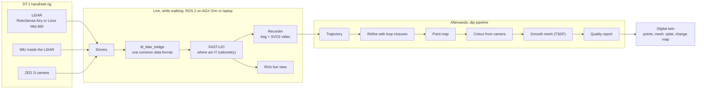

# DT-1 Digital Twin: project documents

This folder explains the whole project in plain words. Each technical term appears in brackets the first time, e.g. "the path the device walked (trajectory)". Every term is also listed in the [glossary](glossary.md).

## What this project is

A person carries a small handheld scanner (the **DT-1 rig**) through a building or a construction site. The scanner has:
- a laser scanner (LiDAR) that measures distances to millions of points;
- a motion sensor (IMU) inside the LiDAR;
- a stereo camera (ZED 2i) that records colour.

A computer (Jetson AGX Orin, or a laptop) records everything. Software then turns the recording into a **3D copy of the place (digital twin)**: a measured, coloured 3D model you can walk around on screen, measure in, and compare with a later visit to see what changed.

Who it is for: Flo Mobility engineers, and anyone joining the project who needs to understand, run or improve it.

## The whole system on one page

## Reading order

| # | Document | Read it to learn |
|---|---|---|
| 1 | [What is a digital twin](01-what-is-a-digital-twin.md) | The idea, why construction sites, what we deliver |
| 2 | [Hardware](02-hardware.md) | The rig, sensors, cables, time sync, coordinate frames |
| 3 | [Software architecture](03-software-architecture.md) | What each folder and package does, how data flows |
| 4 | [Live capture](04-live-capture.md) | What happens while you walk and record |
| 5 | [Post-processing](05-post-processing.md) | How the recording becomes a 3D model |
| 6 | [Simulation](06-simulation.md) | The Blender virtual site used to test everything |
| 7 | [Setup and run](07-setup-and-run.md) | Copy-paste commands: install, record, process, view |
| 8 | [Quality and results](08-quality-and-results.md) | How we measure quality, and what we got so far |
| 9 | [Issues and roadmap](09-issues-and-roadmap.md) | What broke, what is fixed, what to do next |
| – | [Glossary](glossary.md) | Every technical word in one plain sentence |

## Other places with more detail

| Folder | What is there |
|---|---|
| `research/` | Background research: market landscape, sensors, algorithms, repos, calibration, sim, map quality |
| `docs/design/` | The two design documents (capture stack, Blender sim) |
| `docs/test-plan/` | The real-hardware test plan for the AGX |
| `docs/analysis/` | Analyses of real captures (capture 1 and capture 3), with images |
