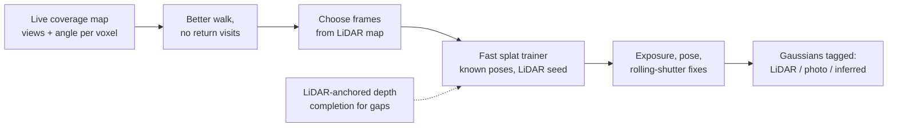

# Can predicting pixels cut recording and processing time? (research)

*2026-10-30. Question: would a model that predicts neighbouring pixels from recorded frames reduce both recording and processing for the twin? Sources are linked inline. **[U]** = read from a snippet or secondary source only. **Inference** = our reasoning, not a source claim. Timings in papers are mostly RTX 4090 and do not transfer directly to our RTX 4060.*

## Answer

The goal is right; pixel prediction is the wrong tool for this rig.

- **Recording:** we already record far more frames than we need, so predicting in-between frames recreates data we discard. What capture lacks is *viewpoints*, and a predicted pixel in an unseen area is a guess.
- **Processing:** every generative or frame-interpolation method reviewed adds compute. None reports a net saving. In our test, splat training time barely changed with frame count; it is set by training steps.
- **Trust:** the twin is measured. Generated content must stay out of measurement, as-built and change-detection data.

What does work: pick frames from the LiDAR map, guide the operator live with a coverage map, use a faster splat trainer, and fix the photometric and pose errors that cap image quality. The one form of "predict neighbouring pixels" worth using is depth completion anchored on LiDAR, labelled as inferred.

## What we measured on capture 3

Data: `~/dt_data/experiments/c3` (current pipeline: walls 27.4 mm, colour 96.5 %, gap 4.2 cm). 367 s, 5,396 preview frames at 960×540.

**Frame redundancy** (50,000 sampled map points, 2,898 frames that moved at least 2 cm or 1°, coarse occlusion test):

| Measure | Result |
|---|---|
| Views per map point | median 286, p10 112 |
| Frames to cover 99 % of points once | 20 |
| Frames to cover 99 % of points 3 times | 57 |
| Frames to cover 99 % of points 5 times | 96 |
| Viewing-angle spread per point | median 15.1°, p90 24.9° |
| Keyframes at 5 cm/4°, 25 cm/10°, 50 cm/30° | 1,023 / 426 / 107 |

**Splat quality vs frame count.** First splats on real data. Same 128 held-out frames for all runs; 10,000 steps at 480×270; LiDAR-seeded (117,731 points), depth loss on, evenly spaced frames, no exposure correction, original `train_splat.py` logic.

| Training frames | PSNR | SSIM | Gaussians | Time |
|---|---|---|---|---|
| 895 | 21.45 dB | 0.719 | 2.41 M | 16.2 min |
| 300 | 21.41 dB | 0.710 | 2.61 M | 12.0 min |
| 100 | 19.20 dB | 0.642 | 3.27 M | 14.8 min |
| 50 | 17.76 dB | 0.589 | 3.04 M | 13.9 min |

What this shows:
1. **Quality plateaus by about 300 frames.** 895 → 300 loses 0.04 dB. Below that it falls: 2.2 dB at 100, 3.7 dB at 50.
2. **Point coverage is not enough for appearance.** 96 frames can cover 99 % of points five times, yet 100 evenly spaced frames lost 2.2 dB. Those are different frame sets, so coverage-chosen frames are still untested.
3. **Training time does not follow frame count.** 50 frames took about as long as 895. Time comes from steps and Gaussian count. Frame selection alone will not speed up splat training.
4. **Something other than frame count caps quality at about 21.5 dB** (the sim reached 39.1 dB). The renders show smeared edges and doubled wobble that the source frames lack. Likely causes (**inference**, not separated yet): auto-exposure, rolling shutter, pose or time offset, the low step count.
5. **Views off the path fail.** A render 1.5 m above the path is fog. That is the coverage problem.

Limits: one room, one capture with poor parallax (rig stayed in a 0.7 m spot), held-out frames close to the path, low resolution, short training, single run per setting. Treat 300 as this capture's figure, not a rule.

**Pixel-prediction test** (added 2026-10-31). Predictor: OpenCV DIS optical flow, a simple stand-in. RIFE could not be run here because the download was blocked by this environment's permissions, so these results are a lower bound for learned models.

Predicting a real held-out frame from one frame either side (127 frames):

| Gap between the two reference frames | Flow prediction | Plain 50/50 blend |
|---|---|---|
| 4 cm, 9° | 22.0 dB | 18.0 dB |
| 8 cm, 18° | 17.6 dB | 15.7 dB |
| 14 cm, 32° | 12.9 dB | 13.1 dB |
| 20 cm, 43° | 11.2 dB | 11.5 dB |

Splat quality with predicted frames added between the same real frames (same 128 held-out frames, poses interpolated between neighbours):

| Training frames | PSNR | SSIM | Gaussians | Time |
|---|---|---|---|---|
| 100 real | 19.20 dB | 0.642 | 3.27 M | 14.8 min |
| 100 real + 99 predicted | 17.12 dB | 0.624 | 2.14 M | 9.7 min |
| 100 real + 297 predicted | 16.12 dB | 0.624 | 1.56 M | 7.2 min |
| 50 real | 17.76 dB | 0.589 | 3.04 M | 13.9 min |
| 50 real + 147 predicted | 15.53 dB | 0.591 | 1.61 M | 7.5 min |
| 300 real, for comparison | 21.41 dB | 0.710 | 2.61 M | 12.0 min |

Predicted frames lowered PSNR in all three runs (by 2.1–3.1 dB) and never approached the same number of real frames. SSIM stayed flat or fell. The shorter times are not a useful speed-up: quality fell and fewer Gaussians grew. Reference gaps here are wide because real frames are sparse, which is exactly the situation the idea targets. A learned model may do better on the direct test; whether it would beat real frames remains untested.

Images: `docs/analysis/img/capture3_splat_frame_sweep.jpg`, `capture3_splat_predicted_frames.jpg`, `capture3_flow_prediction_example.jpg`.

## Where the time goes now

`documents/` still says 56 min. A full cold re-run of the current pipeline on capture 3 (2026-11-01) took **7.9 min** without a splat: ingest 90 s, refine 66 s, fuse 97 s, colour 204 s, report 17 s. The 3.4 min in the 2026-10-22 notes was not reproduced. A low-resolution splat takes 12–16 min on the laptop, so **the splat is now the slowest step**, and it is the only step that needs pixels.

## Evidence: generated pixels

Gains are from each paper's own table; datasets differ, so rows do not compare.

| Method | Input | PSNR gain | Added cost |
|---|---|---|---|
| [Difix3D+](https://arxiv.org/abs/2503.01774) ([non-commercial](https://github.com/nv-tlabs/Difix3D/blob/main/LICENSE.txt)) | Renders + reference | +0.85 dB | 76 ms per frame (A100) |
| [NVIDIA Fixer](https://huggingface.co/nvidia/Fixer) (commercial OK) | Single image | not found | 26.5 ms (H100) |
| [FlowR](https://arxiv.org/abs/2504.01647) | Sparse or dense | 12 views +1.57; 24 views +0.83; dense +0.27 | ~6.5 → ~50 min; 17–42 GB |
| [GenFusion](https://arxiv.org/abs/2503.21219) | 3/6/9 views | +2.23 / +2.20 / +1.57 | ~40 min per scene |
| [GSFixer](https://arxiv.org/abs/2508.09667) | 3/6/9 views | +2.49 / +2.00 / +1.55 | time not reported |
| [ViewCrafter](https://github.com/Drexubery/ViewCrafter) | 1–2+ images | not verified | 120 s per 25 frames; 23.5 GB |
| [InstantSplat](https://arxiv.org/abs/2403.20309) | 3–12 views, no SfM | SSIM .76 vs .38 | Faster, but its benefit is pose-free input, which we do not need |

Frame interpolation specifically:
- Dense video: only [+0.35 dB and +0.17 dB](https://arxiv.org/abs/2412.01553), and the authors suspect interpolation errors worsened pose error.
- Sparse forward-facing views: [useful gains](https://arxiv.org/abs/2603.01099) (20.68 vs 19.24 dB at 3 views). The same paper says it fails on fine detail and causes pose mismatch.
- [RUSplatting](https://arxiv.org/abs/2505.15737) warns of artefacts at large gaps and down-weights interpolated frames.

For the idea:
- Real perceptual gains in sparse capture (1–3 dB above).
- Plain splats can measure well where evidence exists: [1–2 cm RMSE on UAV data](https://arxiv.org/abs/2603.24716).

Against the idea:
- Generative priors give ["limited gains in geometry"](https://arxiv.org/html/2510.12099): F-score fell 59.17 → 56.99.
- Diffusion can [overwrite correct regions](https://arxiv.org/html/2511.21113) and [hallucinate content](https://arxiv.org/html/2512.10369v2) where evidence is missing.
- [FlowR will not fill large unseen areas](https://arxiv.org/abs/2504.01647); Difix3D+ struggles where reconstruction failed.
- [Coverage drives quality](https://arxiv.org/html/2607.01556): 5.84 dB extrapolation gap, against 0.09–0.17 dB from loss regularisers.
- Industry: splats ["inherit that accuracy, they do not generate it"](https://aecmag.com/technology/introducing-gaussian-splats-for-aec/). "No contract yet defines what a splat scene represents in legal terms" (same article).
- [Even real, cleaned splats can degrade](https://isprs-annals.copernicus.org/articles/XI-M-1-2026/31/2026/isprs-annals-XI-M-1-2026-31-2026.pdf): mean cloud-to-cloud error 16 → 136 mm against TLS in one building.

Not found: any standard, vendor or court position on generated reconstruction, and any study of hallucination causing missed or false changes. That risk is **inference**. [USIBD LOA](https://lidarmag.com/2025/02/09/usibd-a-new-chapter-for-2025/) covers measured data and derived models [U].

## Evidence: faster reconstruction

| Trainer | PSNR / time (Mip-NeRF 360, RTX 4090) | Peak VRAM | Licence |
|---|---|---|---|
| 3DGS (baseline) | 27.53 / 20.9 min | 9.89 GB | Inria, non-commercial |
| [FastGS](https://arxiv.org/html/2511.04283v3) | 27.56 / 1.93 min | 5.21 GB | [MIT](https://github.com/fastgs/FastGS/blob/main/LICENSE) but [ships the Inria licence](https://github.com/fastgs/FastGS/blob/main/LICENSE_ORIGINAL.md): treat as non-commercial until reviewed |
| [Faster-GS](https://arxiv.org/html/2602.09999) | 27.56 / 4 min 31 s | 6.1 GiB | [Apache-2.0](https://github.com/nerficg-project/faster-gaussian-splatting) |
| [DashGaussian](https://github.com/YouyuChen0207/DashGaussian) | 27.70 / 6.21 min | 9.96 GB | CC BY-NC-SA |

Feed-forward models do not fit: [ReSplat's](https://arxiv.org/html/2510.08575) lead over 3DGS shrinks from +2.76 dB at 8 views to +0.44 at 32; [StreamSplat](https://arxiv.org/html/2608.01659v1) needs 87.3 GB for 1,024 views at 18 dB; [AnySplat](https://arxiv.org/html/2505.23716v1) reaches about 19.5 dB at 200 views and 64 GB at 128. Linear scaling from [VGGT-Omega's table](https://github.com/facebookresearch/vggt-omega) gives about 25 frames in 8 GB (**inference**).

Dense initialisation alone does not speed training: [DensifyBeforehand](https://arxiv.org/html/2511.19294) (iPad LiDAR) cut Gaussians 2.5–3.6× but time stayed 403 vs 408 s.

Closest benchmark to our setup: [SIGGRAPH Asia 2025 winner](https://arxiv.org/html/2601.19489), SLAM poses + point cloud, 25.48 dB in 60 s on an RTX 4090, on short videos.

Live feedback exists: [Immediate 3DGS](https://arxiv.org/html/2607.14481) at 324 ms latency (RTX 4090, no code seen). [GauSS-MI](https://arxiv.org/html/2504.21067) scores views in 5.55 ms. No published numeric coverage metric for human operators was found; that is an opening for us.

Jetson: [GS-LIVO](https://arxiv.org/html/2501.08672) ran on an Orin NX at 256×216, 23.52 dB, 48 ms per frame. No full offline 3DGS training on AGX Orin was found.

## Evidence: using LiDAR to fill and accelerate

| System | Runtime | Quality | Licence |
|---|---|---|---|
| [Gaussian-LIC2](https://arxiv.org/pdf/2507.04004) | 150 s sequence in 90 s, RTX 4090 | 24–25 dB; 18–23 off-sequence | [GPL-3](https://github.com/APRIL-ZJU/Gaussian-LIC) |
| [GS-LIVO](https://arxiv.org/pdf/2501.08672) | 82 s vs 3DGS 2,129 s | 25.34 vs 26.22 dB | not checked |
| [GS-SDF](https://arxiv.org/pdf/2503.10170) | offline | 26.99 dB | [GPL-2](https://github.com/hku-mars/GS-SDF) |
| [Structured-Li-GS](https://arxiv.org/pdf/2606.27509) | offline | Hilti construction 23.96 vs 3DGS 22.00 | not checked |

Published real-rig results sit at about 24–28 dB, so 21.5 dB at 480×270 and 10k steps is a plausible start. Cross-paper numbers are unreliable: MonoGS on one sequence is [18.74](https://arxiv.org/pdf/2507.04004) in one paper and [25.53](https://arxiv.org/pdf/2604.12942) in another.

Depth completion is "predict neighbouring pixels" anchored on measurement:
- [KITTI relative error and time](https://arxiv.org/pdf/2608.04737): OMNI-DC 1.48 %, 638 ms; Prior Depth Anything 2.76 %, 197 ms; PromptDA 2.90 %, 30 ms; Marigold-DC 5.50 %, 6.5 s.
- Gaussian-LIC2 uses it carefully: [fast completion only seeds Gaussians in patches with no LiDAR](https://arxiv.org/pdf/2507.04004), after a consistency check, and depth supervision stays on real LiDAR.
- [SurfFill](https://arxiv.org/pdf/2512.03010) (NavVis co-authors): image-guided LiDAR completion, 5.5 mm vs 61.8 mm Chamfer.
- About 1.5 % relative error is about 15 cm at 10 m (**inference**), so completed depth is not a measurement.

Photometric recovery, likely our quality ceiling:
- [Seiskari et al.](https://arxiv.org/pdf/2403.13327) (phones): full model +1.68 dB; pose refinement +1.15, rolling shutter +0.97, blur +0.60. Training 19 → 91 min, mostly blur; rolling-shutter gain varies by camera.
- [BAD-Gaussians](https://arxiv.org/pdf/2403.11831): +3.4 dB under severe blur, likely an upper bound.
- Gaussian-LIC2 reports [severe rolling shutter hurts rendered depth](https://arxiv.org/pdf/2507.04004). No handheld LiDAR-splat system with an explicit rolling-shutter model was found.

Commercial pattern: [XGRIDS LCC](https://www.prnewswire.com/news-releases/xgrids-unveils-lcc-pioneering-slam-based-gaussian-splatting-software-for-rapid-photorealistic-3d-environment-creation-302424505.html) (10 → about 100 min), [NavVis](https://knowledge.navvis.com/docs/how-to-visualize-in-3d-with-navvis-gaussian-splatting) (splat measuring [backed by the point cloud](https://radiancefields.com/navvis-adds-gaussian-splats-to-ivion-12-as-a-third-visualization-mode) [U]), and FARO pair LiDAR geometry with trained appearance. Matterport's generative [Defurnish](https://support.matterport.com/s/article/Defurnish-your-Space?language=en_US) [U] is a flagged approximation in a separate view. None advertises AI-completed survey geometry.

## Proposed direction (to agree before building)

1. **Live coverage map (cuts recording).** On the Orin, keep per-voxel view count and angular spread on the LIO map, and show the gaps in the existing motion coach. No GPU training needed. Target: stop when covered, and never return to site.
2. **Frame selection from the map (cuts data).** Score frames by new coverage, new viewing angle and sharpness. Test against evenly spaced frames.
3. **Faster-GS as the trainer (cuts processing).** Apache-licensed. Target: single-digit minutes per room (**rough estimate**).
4. **Lift the quality ceiling.** Lock exposure, then per-image exposure, pose refinement, then measure ZED readout before adding a rolling-shutter model.
5. **Depth completion, only for gaps.** Seed Gaussians where LiDAR is absent, tagged as inferred.
6. **Provenance rule.** Tag every Gaussian as LiDAR-supported, photo-only or generated. Measurement and change detection use LiDAR-supported data only. Any generative fill is a separate labelled viewer layer.

Decisive experiments, in order:
1. A true walking capture, with a far-from-path holdout, repeating the sweep.
2. Coverage-chosen vs evenly spaced frames at 100 and 300.
3. Isolate the ceiling on capture 3 with per-image exposure, pose refinement, and 30k steps at full resolution.

## Licence watch-outs

Non-commercial: Inria 3DGS, Difix3D, DashGaussian code, DUSt3R, Depth Anything 3 Large and Giant. GPL: FAST-LIVO2, GS-SDF, Gaussian-LIC2. Reimplementing a published idea may be separate from using the code; ask legal. Cleanest base: gsplat + Faster-GS, both Apache.

## Gaps in this review

- Not opened: SparseGS, GaussianObject, Deceptive-NeRF, LIV-GaussMap, LiV-GS, LightGaussian, EAGLES, Scaffold-GS, and the original OMNI-DC, DepthLab and PromptDA papers (their numbers are third-party).
- MDPI pages returned 403, so [DiffLiGS](https://www.mdpi.com/2220-9964/15/4/140) and the IJGI 2026 super-resolution paper are snippet-only and excluded above.
- Most sources were read through a summarising fetch. Check a number in the paper before quoting it externally.
